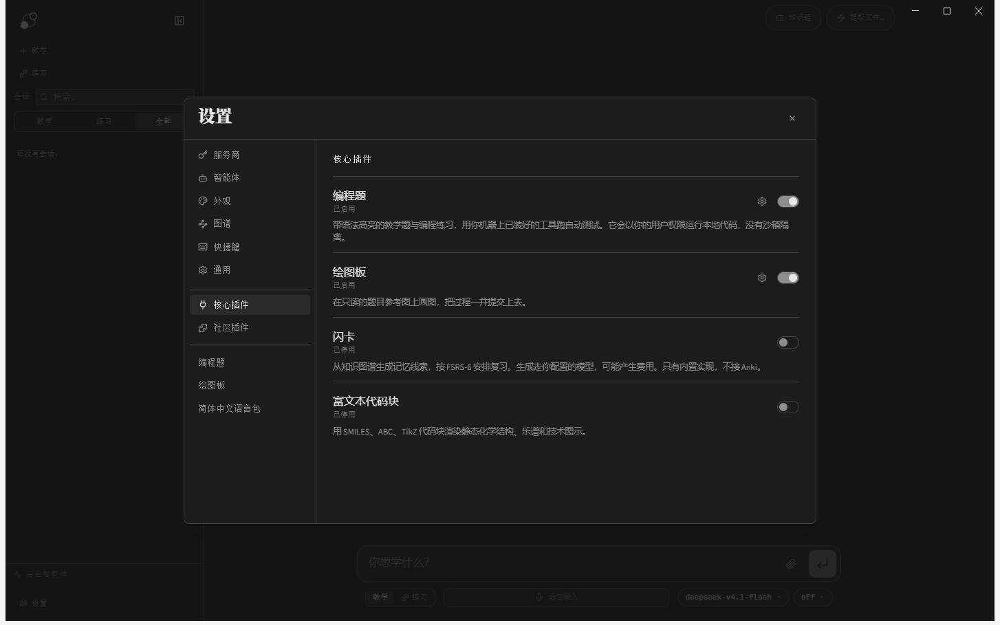

# LearnHarness 简体中文语言包

一个 LearnHarness 社区插件：装上以后，界面文案变成简体中文。

MIT License · 适配 LearnHarness 0.6.1+ · 纯前端注入，不改应用文件

- 不改动应用任何文件，纯前端运行时替换，卸载即恢复原样。
- 通过公开的插件 API（`apiVersion: 1`）加载，用的是插件 `main.js` 在应用窗口里的正常 DOM 权限，不需要改打包产物、不注入宿主代码。
- 词表 **1176 条**，覆盖侧边栏、首页、设置全部十个分区、插件页（含核心插件卡片名与说明、插件设置页）、确认框、空态、错误提示、快捷键名；连单单词按钮（保存/中止/提交/已复制）、状态徽章（运行中/已解出/已绑定）、相对时间（5 分钟前）、数量与名词（3 个节点、已选中 3 个节点）、拼出来的句子（版本 0.6.1、工具 · 检索）都在内。



## 安装

### 方式一：git clone（官方推荐，升级只要 `git pull`）

插件目录的文件夹名必须等于插件 id `zh-cn-language-pack`，所以 clone 时指定目录名：

```
git clone https://github.com/jieye666/learnharness-zh-cn "<插件目录>/zh-cn-language-pack"
```

Windows 一行：

```powershell
git clone https://github.com/jieye666/learnharness-zh-cn "$env:APPDATALearnHarnessdatapluginszh-cn-language-pack"
```

clone 下来仓库根目录里就有 `dist/`，布局正好是 `<插件目录>/zh-cn-language-pack/dist/{main.js,manifest.json}`。

### 方式二：只拷 dist

1. 打开 LearnHarness → 设置 → 社区插件，记下「插件目录」（通常是
   `C:\Users\<你>\AppData\Roaming\LearnHarness\data\plugins`，macOS 为
   `~/Library/Application Support/LearnHarness/data/plugins`）。
2. 把本仓库的 `dist/` 整个复制进去，并改名为 `zh-cn-language-pack`：

   ```
   <插件目录>/zh-cn-language-pack/dist/main.js
   <插件目录>/zh-cn-language-pack/dist/manifest.json
   ```

   Windows PowerShell 一行：

   ```powershell
   $dst = "$env:APPDATA\LearnHarness\data\plugins\zh-cn-language-pack"
   New-Item -ItemType Directory -Force "$dst\dist" | Out-Null
   Copy-Item .\dist\* "$dst\dist" -Force
   ```

3. 回到「社区插件」，点一行刷新，出现「简体中文语言包」后把开关打开 —— 界面立刻变中文。
4. 新增插件默认是关闭的，别忘了这一步。

卸载：关掉开关（界面立刻恢复英文），或直接删掉 `zh-cn-language-pack` 文件夹并重启应用。

## 它是怎么工作的

插件 `main.js` 是宿主窗口里的普通 ES module，`activate(context)` 时：

1. 用 `TreeWalker` 走文本节点，用 `querySelectorAll` 走
   `placeholder / data-placeholder / aria-placeholder / title / aria-label / alt`
   属性，做**整串精确匹配**替换（`dict.source.json` 里的键必须和原文完全一致，含大小写与标点）。
2. `MutationObserver` 盯 `childList / subtree / characterData` 和上述属性，React 后渲染的内容也会被译到；另有一个 1.2 秒的属性轮询兜底。
3. 记住每处改动的原值，插件被关掉时逐条还原。
4. 跳过 `<script>/<style>/<code>/<pre>/<kbd>` 和一切 `contenteditable` 区域 —— 你在输入框和编辑器里写的字不会被改。

拼出来的动态文案靠三层规则（顺序：词表 → 片段 → 正则规则）：

- 词表里含 `{0}` 的条目自动编译成锚定正则，例如 `Plan · {0} node{1}` → `计划 · {0} 个节点{1}`（连着把英文复数 s 吞掉）。
- 手写规则：`Version 0.6.1 → 版本 0.6.1`、`Tool · research → 工具 · 检索`、`3 nodes selected → 已选中 3 个节点`。
- 时间与数量：`5m ago → 5 分钟前`、`just now → 刚刚`；数字和名词被 JSX 拆成两个文本节点时（`3` + `nodes`），靠前一个兄弟节点以数字结尾来补译成「个节点」。

## 有意不翻译的部分

- 品牌与产品名：Learning Harness、ChatGPT、GitHub Copilot、Claude Code、Deepgram、Tavily、Exa、Firecrawl、Ollama、Grok。
- 主题名（Cappuccino Latte…）、字体名、模型 id。
- 提示词（给模型看的字段说明）、API 返回的内部错误、路由与枚举值。
- 设置里个别「既是显示标签又是分组 id」的字符串（如 `DICTATION`、键位分组 `Search`），单侧翻译会导致分组判断失效，故保持英文。

## 开发

```
dict.source.json   词表（key = 界面英文原文，value = 中文）
sources/*.json     分批补充的词表和子代理判定结果，由 tools/merge-extras.mjs 合并进 dict.source.json
src/runtime.js     运行时；__DICT__ 占位符由构建注入
build.mjs          生成 dist/main.js + dist/manifest.json
tools/check-jsx-text.mjs   列出 JSX 文本子节点里还没收录的文案（最接近真实上屏）
tools/check-jsx-props.mjs  同上，看 label/title/placeholder 等属性位置
tools/check-coverage.mjs   拿 SSR HTML 体检：还剩哪些英文没译
/tools/test-runtime.mjs     运行时单测（模板/时间/量词/复数）
tools/merge-extras.mjs      合并 sources/*.json，冲突会打印出来让人裁决
```

改完词表后：

```
node tools/merge-extras.mjs --write   # 如果改了 sources/ 里的分片
node build.mjs
node tools/check-jsx-text.mjs         # 确认没有漏网的可见文案
```

然后把 `dist/` 重新复制到插件目录，**重启应用**（已加载的插件代码不会热更）。

这些检查工具需要一个 LearnHarness 源码检出，路径写死在文件顶部（`SRC`），按需改。

## 覆盖情况（0.6.1 源码实测）

- 首页 `/` 与新建会话页 `/chat/new` 的 SSR HTML：除 `Learning Harness`（品牌）、TURBOPACK 引导代码、SVG path 外无英文。
- 源码里 JSX 文本子节点 315 处英文：仅剩 21 处是代码片段与品牌名。
- JSX 属性位置 256 处英文：仅剩 ChatGPT、Claude Code 两个品牌名。

## 已知限制

- 带变量的句子只有进了词表（写成 `{0}`）或被手写规则覆盖才译得出来；没进词表、又是由多段拼接的句子会留英文。
- 极少数「既是显示标签又是分组 id」的字符串保持英文（`DICTATION`、键位分组 `Search`），否则单侧翻译会让分组判断失效。
- 依赖 DOM，所以纯 canvas 内容、原生窗口标题栏菜单不在范围内。
- 实测于 LearnHarness 0.6.1（Windows）。应用大版本升级后可能新增未收录文案，跑一次 sweep 补词表即可。
- 关掉开关的还原路径按记录回写，若应用在插件运行期间自行改动了同一段文本，极少数情况下可能还原成旧值；重启应用即可彻底恢复。

## 许可证

MIT，见 [LICENSE](LICENSE)。

## 反馈

LearnHarness 本身的问题请提到 [上游仓库](https://github.com/amosblomqvist/learnharness/issues)；这个语言包的漏译、错译提到本仓库的 Issues，附上截图和所在界面最快。
